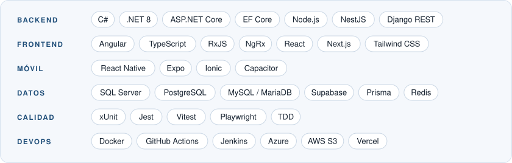

<picture>
  <source media="(prefers-color-scheme: dark)" srcset="assets/banner-dark.svg">
  
</picture>

Desarrollador Full Stack con más de 3 años construyendo aplicaciones web y móviles: ERPs, portales y apps publicadas en App Store y Google Play. En empresa trabajo sobre todo con **C#/.NET y Angular**; en producto propio, con **React, Next.js y React Native**.

- Mantengo **Swapadel** en producción en iOS, Android y web.
- Estoy probando **MPL** en beta con un profesor de pádel y sus alumnos.
- Busco nuevo puesto como desarrollador Full Stack: remoto, híbrido o presencial.

> La mayor parte de mi código es de empresa o de productos en producción, por eso casi todos mis repositorios son privados. Si quieres ver código concreto, escríbeme.

## Proyectos

**[Swapadel](https://apps.apple.com/es/app/swapadel/id6760138920)** · en producción 
App para intercambiar y probar palas de pádel, con match, chat y datos en tiempo real. Seguridad a nivel de fila (RLS) en PostgreSQL y notificaciones push. 
`React Native` `Expo` `Next.js` `Supabase` `TypeScript` 
[App Store](https://apps.apple.com/es/app/swapadel/id6760138920) · [Google Play](https://play.google.com/store/apps/details?id=com.palamatch.mobile&hl=es)

**MPL · My Padel Lessons** · beta 
App para dar y recibir clases de pádel, con agenda por sedes, API REST autenticada con JWT y pagos con Stripe. 
`React Native` `Expo Router` `Django REST Framework` `Stripe`

**FoodWare** · en desarrollo 
Gestión para una distribuidora de alimentos: pedidos con reserva de stock transaccional, incidencias clasificadas con IA y un centro logístico con almacén 3D. Será público cuando esté terminado. 
`Next.js` `Prisma` `PostgreSQL` `Vitest` `Playwright`

## Stack

<picture>
  <source media="(prefers-color-scheme: dark)" srcset="assets/stack-dark.svg">
  
</picture>

## Cómo trabajo

- **Especificación antes que código:** cada funcionalidad parte de una spec y un plan por tareas (SDD), y se implementa con tests primero (TDD).
- **IA con control:** uso agentes como Claude Code y OpenCode para implementar, pero cada cambio pasa por pull request, revisión y la batería de tests antes de llegar a `main`.
- **CI en cada PR:** tests unitarios, de integración y end-to-end en GitHub Actions, con commits convencionales y PRs pequeños.

## Contacto

[LinkedIn](https://linkedin.com/in/javiergalvanpoley) · [Portfolio](https://jgpdev8.github.io/PortfolioJGPDEV8) · jgpdev8@gmail.com
